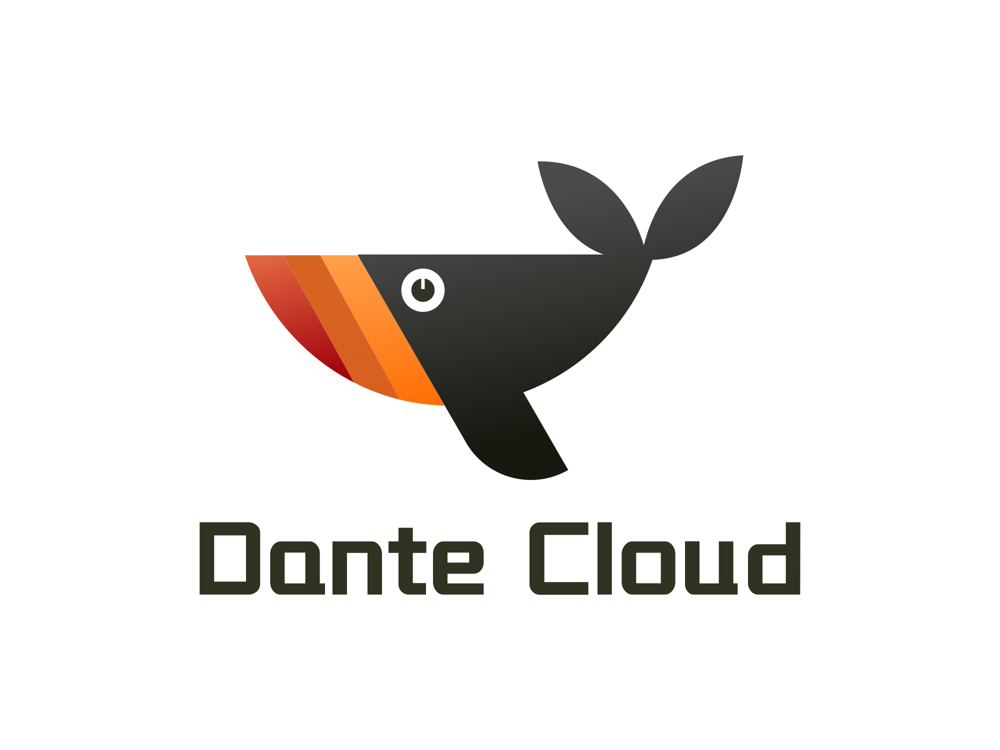

<p align="center"></p>
<h2 align="center">简洁优雅 · 稳定高效 | 宁静致远 · 精益求精 </h2>
<p align="center">“一套代码、两种架构，可以灵活切换微服务和单体两种架构”的企业级微服务系统</p>

---

<p align="center">
    <a href="https://spring.io/projects/spring-boot" target="_blank"></a>
    <a href="https://spring.io/projects/spring-cloud" target="_blank"></a>
    <a href="https://github.com/alibaba/spring-cloud-alibaba" target="_blank"></a>
    <a href="https://github.com/Tencent/spring-cloud-tencent" target="_blank"></a>
    <a href="https://spring.io/projects/spring-ai" target="_blank"></a>
    <a href="https://nacos.io/docs/latest/overview/" target="_blank"></a>
</p>
<p align="center">
    <a href="https://my.oschina.net/pointerv" target="_blank"></a>
    <a href="./LICENSE"></a>
    <a href="https://bell-sw.com/pages/downloads/#downloads" target="_blank"></a>
    <a href="https://github.com/dante-compass/dante-engine" target="_blank"></a>
    <a href="https://github.com/dromara/dante-cloud" target="_blank"></a>
    <a href="https://github.com/dante-compass/thingsbrain" target="_blank"></a>
    <a href="https://github.com/dante-compass/dante-cloud-ui" target="_blank"></a>
    <a href="https://github.com/dante-compass/herodotus-cloud-ui-vuetify" target="_blank"></a>
    <a href="https://github.com/dante-compass/dante-engine"></a>
    <a href="https://github.com/dante-compass/dante-engine"></a>
    <a href="https://gitee.com/dante-compass/dante-engine"></a>
    <a href="https://gitee.com/dante-compass/dante-engine"></a>
    <a href='https://atomgit.com/dante-compass/dante-engine'></a>
    <a href="https://www.herodotus.cn"></a>
    <a href="https://deepwiki.com/dante-compass/dante-engine" target="_blank"></a>
</p>
<p align="center">
    <a href="https://github.com/dante-compass/dante-engine">Github 仓库</a> &nbsp; | &nbsp;
    <a href="https://gitee.com/dante-compass/dante-engine">Gitee 仓库</a> &nbsp; | &nbsp;
    <a href="https://atomgit.com/dante-compass/dante-engine">Atomgit 仓库</a> &nbsp; | &nbsp;
    <a href="https://www.herodotus.cn">在线文档</a>
</p>

---

## 项目介绍

**Dante Cloud** 国内首个支持阻塞式和响应式服务并行的、开箱即用的企业级云原生微服务基座和面向 AI Agent 开发的智能基座。是采用**领域驱动模型(DDD)**设计思想，以「**高质量代码、低安全漏洞**」为核心，基于 Spring 生态全域开源技术，高度**模块化和组件化设计**，支持**智能电视、IoT等物联网设备**认证，满足**国家三级等保要求**，支持**接口国密数字信封加解密**等一系列安全体系的一站式多租户微服务解决方案。独创的可以“**一套代码实现微服务和单体两种架构灵活切换**”的企业级应用系统，赋能企业级智能应用构建。

Dante Engine 为 Dante Cloud 微服务项目核心组件库，是 Dante Cloud 项目核心内容。单独提取一个工程，一方面便于多项目共享代码，提升代码维护的便捷性；另一方面，Dante Engine 已经提前编译完成并发布中央仓库，可以极大地提升 Dante Cloud 主工程的编译效率。

# [一]、开源协议

## 1. 协议声明

自 **v3.3.6.0** 版本起，Dante Cloud 以及 Dante Engine 子项目开源协议 **【永久】** 变更为为 Apache License Version 2.0。可用于个人学习、毕设，允许商业使用，禁止二次开源。严禁搬运至 CSDN 下载等平台进行售卖。

## 2. 补充条款

**使用时务必遵守以下补充条款：**

- 不得将本软件应用于危害国家安全、荣誉和利益的行为，不能以任何形式用于非法为目的的行为。
- 在延伸的代码中（修改现有源代码衍生的代码中）需要带有原来代码中的协议、版权声明和其他原作者规定需要包含的说明（请尊重原作者的著作权，不要删除或修改文件中的Copyright和@author信息） ，更不要全局替换源代码中的 Dante Cloud、Dante Engine、ThingsBrain 或 码匠君 等字样，否则你将违反本协议条款承担责任。
- 您若套用本软件的一些代码或功能参考，请保留源文件中的版权和作者，需要在您的软件介绍明显位置 说明出处，举例：本软件基于 Dante Cloud 微服务架构 Dante Engine 或 ThingsBrain，并附带链接：<https://www.herodotus.cn>
- 任何基于本软件而产生的一切法律纠纷和责任，均与作者无关。
- 如果你对本软件有改进，希望可以贡献给我们，双向奔赴互相成就才是王道。
- 本项目已申请软件著作权，请尊重开源。

如果您确实需要删除作者或版权信息，需要争得作者同意及授权。或者在 [【使用公司及组织】](https://gitee.com/dromara/dante-cloud/issues/ICAOHG) 下进行登记，经作者整理登记信息形成表格后，可视为正式授权。

# [二]、工程结构

`Dante Cloud` 自 2.7.X 版本起，由原有单一的工程拆分为 `Dante Cloud` 和 `Dante Engine` 两个工程。`Dante Cloud` 为主要应用运行以及子模块组合工程，`Dante Engine` 为核心组件库工程。

该种设计是对于原有工程代码高度抽象，不仅可以提升底层通用代码的复用性，让代码不局限于 `Dante Cloud` 项目本身还可以为更多的项目所使用。用户使用 `Dante Cloud`，收获的不仅是一套微服务系统，更是一套可以灵活拆分和状态装配的组件库。可以像乐高一样随意组合搭建您自己的应用系统。

**主工程以及前端工程代码地址，详见下方【项目地址】章节！**

```shell
dante-engine
├── dante-assistant -- 辅助功能模块
├    ├── dante-assistant-access -- 第三方登录接入辅助功能模块
├    ├── dante-assistant-captcha -- 验证码辅助功能模块
├    └── dante-assistant-oss -- AWS SDK V2 对象存储辅助功能模
├── dante-data -- 数据访问模块
├    ├── dante-data-commons -- 数据访问通用代码模块
├    ├── dante-data-jpa -- 以 JPA 作为数据访问层的通用代码模块
├    └── dante-data-rest -- 关联数据访问层的REST开发通用代码模块
├── dante-dependencies -- 工程 Bom 定义，统一管理工程模块
├── dante-framework -- Dante Cloud 框架核心基础模块
├    ├── dante-autoconfigure -- 基础自动配置模块
├    ├── dante-cache -- 缓存相关基础代码模块
├    ├── dante-core -- 核心定义模块
├    ├── dante-hibernate -- Hibernate 扩展模块
├    ├── dante-messaging -- Messaging 相关基础代码模块
├    ├── dante-security -- Security 相关基础代码模块
├    ├── dante-spring -- SpringBoot 相关基础代码模块
├    └── dante-web -- Web 服务相关基础代码模块
├── dante-logic -- 系统内置功能业务逻辑模块
├    ├── dante-logic-identity -- 身份认证功能业务逻辑模块
├    ├── dante-logic-message -- 系统消息业务逻辑模块
├    └── dante-logic-upms -- UPMS 业务逻辑模块
├── dante-message -- 消息模块
├    ├── dante-message-autoconfigure -- 消息自动配置模块
├    ├── dante-message-emqx -- Emqx 封装模块
├    └── dante-message-servlet-websocket -- 基于 Servlet 环境下的 Websocket 功能封装模块
├── dante-oauth2 -- OAuth2 认证模块
├    ├── dante-authentication-autoconfigure -- OAuth2 授权服务器基础内容自动配置模块
├    ├── dante-authorization-autoconfigure -- OAuth2 资源服务器基础内容自动配置模块
├    ├── dante-oauth2-authentication -- Spring Authorization Server 授权服务器核心功能封装模块
├    ├── dante-oauth2-authorization -- Spring Authorization Server 资源服务器核心功能封装模块
├    ├── dante-oauth2-commons -- OAuth2 共性通用代码模块
├    └── dante-oauth2-extension -- Spring Authorization Server 功能扩展模块
├── dante-persistence -- 数据访问层模块
├    ├── dante-persistence-commons -- 数据访问层通用代码模块
├    ├── dante-persistence-autoconfigure -- 数据访问层模块自动配置
├    └── dante-persistence-sas-jpa -- 以 JPA 作为 SAS 核心数据访问层代码实现模块
├── dante-rest -- 系统内置功能 REST 接口模块
├    ├── dante-rest-oss -- 对象存储功能 REST 接口模块
├    ├── dante-rest-identity -- 身份认证功能 REST 接口模块
├    ├── dante-rest-message -- 消息功能 REST 接口模块
├    └── dante-rest-upms -- UPMS 功能 REST 接口模块
├── dante-starter -- Starters
├    ├── cache-spring-boot-starter -- 缓存自动配置 Starter
├    ├── data-rdbms-spring-boot-starter -- 关系型数据库数据访问层自动配置 Starter
├    ├── logging-spring-boot-starter -- 日志收集和聚合自动配置 Starter
├    ├── oss-spring-boot-starter -- 基于 AWS SDK V2 对象存储自动配置 Starter
├    ├── reactive-container-spring-boot-starter -- Reactive 容器基础配置自动配置 Starter
├    ├── servlet-container-spring-boot-starter -- 基于 JPA 的多租户自动配置 Starter
├    ├── servlet-message-spring-boot-starter -- Servlet 环境消息模块自动配置 Starter
├    ├── tenant-spring-boot-starter -- 基于 JPA 的多租户自动配置 Starter
├    ├── web-spring-boot-starter -- Web 微服务通用 Starter
├    └── webmvc-spring-boot-starter -- WebMvc 类型应用自动配置 Starter
└──  readme -- README 相关素材放置目录
```

# [三]、版本分支

## 1. 版本号说明

本系统版本号，分为四段。

- 第一段、第二段和第三段，与 Spring Boot 版本对应，根据采用的 Spring Boot 版本变更。例如，当前采用 Spring Boot 2.4.6 版本，那么就以
  2.4.6.X 开头
- 第四段，表示在当前 Spring Boot 版本下，系统功能维护及优化情况。

## 2. 分支说明

|        分支名称        | 对应 Spring 生态版本                     | 对应 JDK 版本 | 用途               | 现状                                                                                           |
|:----------------------:|------------------------------------------|---------------|--------------------|------------------------------------------------------------------------------------------------|
|         master         | Spring Boot 4.1 和 Spring Cloud 2025.1.4 | JDK 25        | 主要发布分支       | 推荐使用代码分支                                                                               |
|        develop         | Spring Boot 4.1 和 Spring Cloud 2025.1.4 | JDK 25        | Development 分支   | 新功能、ISSUE 均以此分支作为开发，发布后会 PR 至 master 分支                                   |
|         4.0.X          | Spring Boot 4.0 和 Spring Cloud 2025.1.1 | JDK 25        | 历史版本，停止维护 | 基于 Spring Boot 4.0 时代开发的代码分支，稳定可用，停止维护                                    |
|         3.5.X          | Spring Boot 3.5 和 Spring Cloud 2025.0.X | JDK 17        | 历史版本，停止维护 | 基于 Spring Boot 3.5 时代开发的代码分支，稳定可用，停止维护                                    |
|         3.4.X          | Spring Boot 3.4 和 Spring Cloud 2024.0.X | JDK 17        | 历史版本，停止维护 | 基于 Spring Boot 3.4 时代开发的代码分支，稳定可用，停止维护                                    |
|      3.2.X-3.3.X       | Spring Boot 3.3 和 Spring Cloud 2023.0.X | JDK 17        | 历史版本，停止维护 | 基于 Spring Boot 3.3 时代开发的代码分支，稳定可用，停止维护                                    |
|         3.1.X          | Spring Boot 3.1 和 Spring Cloud 2022.0.X | JDK 17        | 历史版本，停止维护 | 基于 Spring Boot 3.1 时代开发的代码分支，稳定可用，停止维护                                    |
|         2.7.X          | Spring Boot 2.7 和 Spring Cloud 2021.0.X | JDK 8         | 历史版本，停止维护 | 基于 Spring Boot 2.7 时代开发的代码分支，稳定可用，停止维护                                    |
| spring-security-oauth2 | Spring Boot 2.6 和 Spring Cloud 2021.0.X | JDK 8         | 历史代码，不再维护 | 基于原 Spring Security OAuth2 实现的微服务，稳定可用，因相关组件均不在维护，所以该版本停止维护 |

# [四]、项目地址

## 1. Dante Cloud 主工程

- **Gitee**：[https://gitee.com/dromara/dante-cloud](https://gitee.com/dromara/dante-cloud)
- **Github**：[https://github.com/dromara/dante-cloud](https://github.com/dromara/dante-cloud)
- **AtomGit**：[https://atomgit.com/dromara/dante-cloud](https://atomgit.com/dromara/dante-cloud)

## 2. Dante Engine 核心组件库

- **Gitee**：[https://gitee.com/dante-compass/dante-engine](https://gitee.com/dante-compass/dante-engine)
- **Github**：[https://github.com/dante-compass/dante-engine](https://github.com/dante-compass/dante-engine)
- **AtomGit**：[https://atomgit.com/dante-compass/dante-engine](https://atomgit.com/dante-compass/dante-engine)

## 3. UI 前端工程（旧版）

- **Gitee**：[https://gitee.com/dante-compass/dante-cloud-ui](https://gitee.com/dante-compass/dante-cloud-ui)
- **Github**：[https://github.com/dante-compass/dante-cloud-ui](https://github.com/dante-compass/dante-cloud-ui)
- **AtomGit**：[https://atomgit.com/dante-compass/dante-cloud-ui](https://atomgit.com/dante-compass/dante-cloud-ui)

## 4. UI 前端工程（新版）

- **Gitee**：[https://gitee.com/dante-compass/herodotus-cloud-ui-vuetify](https://gitee.com/dante-compass/herodotus-cloud-ui-vuetify)
- **Github**：[https://github.com/dante-compass/herodotus-cloud-ui-vuetify](https://github.com/dante-compass/herodotus-cloud-ui-vuetify)

## 5. ThingsBrain 基于 Dante Cloud 的物联网平台

- **Gitee**：[https://gitee.com/dante-compass/thingsbrain](https://gitee.com/dante-compass/thingsbrain)
- **Github**：[https://github.com/dante-compass/thingsbrain](https://github.com/dante-compass/thingsbrain)

# [五]、安全测试

Dante Cloud 已通过由第三方进行的软件出厂安全测试。详情参见：[安全测试](https://www.herodotus.cn/guide/security/compliance.html)

# [六]、安全测试

1. 在 Gitee fork 项目到自己的 repo
2. 把 fork 过去的项目也就是你的项目 clone 到你的本地
3. 修改代码（记得一定要修改 develop 分支）
4. commit 代码，push 到自己的库（develop 分支）
5. 登录 Gitee 在你首页可以看到一个 pull request 按钮，点击它，填写一些说明信息，然后提交即可。
6. 等待维护者合并

# [七]、鸣谢

## 赞助人列表

| 序号 |                    赞助人                    |  赞助时间  | 序号 |                     赞助人                     |  赞助时间  | 序号 |                   赞助人                    |  赞助时间  |
|:----:|:--------------------------------------------:|:----------:|:----:|:----------------------------------------------:|:----------:|:----:|:-------------------------------------------:|:----------:|
|  1   |                  ご沉默菋噵                  | 2021-10-25 |  2   |  [偷土豆的人](https://gitee.com/dongzongyang)  | 2021-11-24 |  3   |     [lorron](https://gitee.com/lorron)      | 2022-04-04 |
|  4   |                    在云端                    | 2022-12-26 |  5   |       [西晽](https://gitee.com/syllvin)        | 2022-12-27 |  6   |  [p911gt3rs](https://gitee.com/p911gt3rs)   | 2023-01-03 |
|  7   |      [jacsty](https://gitee.com/jacsty)      | 2023-01-31 |  8   |  [hubert_rust](https://gitee.com/hubert_rust)  | 2023-03-16 |  9   |    [Zkey Z](https://gitee.com/zkeyzvip)     | 2023-03-18 |
|  10  |     [志国欧巴](https://gitee.com/zzgf16)     | 2023-03-27 |  11  |  [michael](https://gitee.com/yiminyangguang)   | 2023-04-07 |  12  | [大叔丨小巷](https://gitee.com/yushui_wang) | 2023-04-11 |
|  13  |    [sun_left](https://gitee.com/sun_left)    | 2023-04-19 |  14  | [time、sand](https://gitee.com/tzy15680905763) | 2023-07-06 |  15  | [印第安老斑鸠](https://gitee.com/deadncut)  | 2023-09-09 |
|  16  |                    一阵风                    | 2023-12-10 |  17  |                      Jack                      | 2024-03-01 |  18  |  [onehelper](https://gitee.com/onehelper)   | 2024-05-24 |
|  19  | [宁哥](https://gitee.com/seabuckthorn-syrup) | 2024-05-29 |  20  | [cryptoneedle](https://gitee.com/cryptoneedle) | 2024-11-01 |  21  |                别吓跑我的鱼                 | 2025-01-10 |
|  22  |  [代码裁缝](https://gitee.com/code-tailor)   | 2025-03-01 |  23  |                    Go ahead                    | 2025-03-10 |  24  |      [hoku](https://gitee.com/hoku888)      | 2025-06-18 |
|  25  |                     飞翔                     | 2025-07-19 |  26  |                                                |            |  27  |                                             |            |

# [八]、关注我

<table align="center">
  <tr>
    <th align="center">
      <p>公众号：码匠君</p>
    </th>
  </tr>
  <tr>
    <td align="center">
      
    </td>
  </tr>
</table>